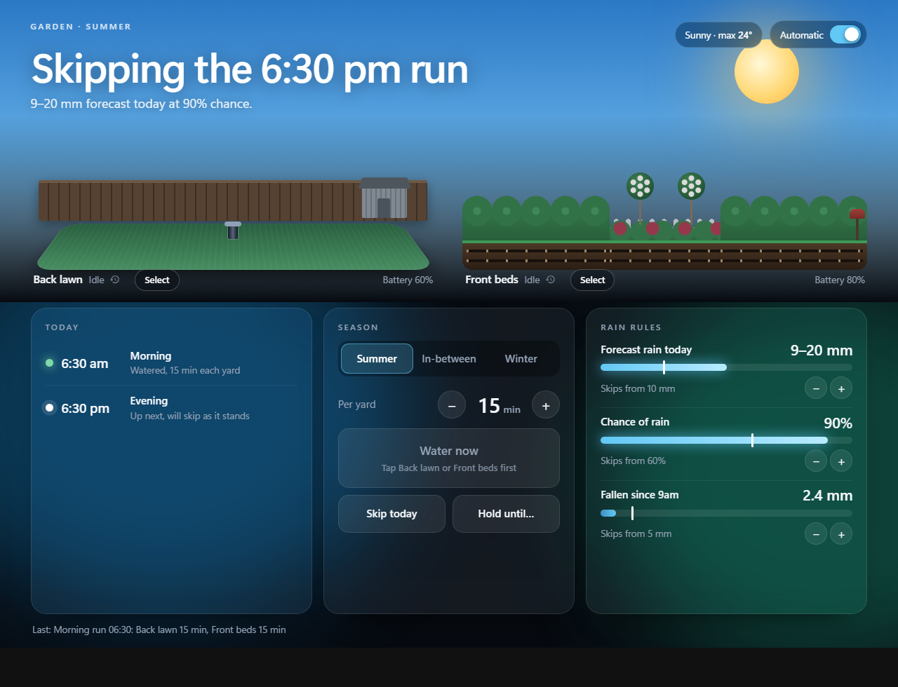
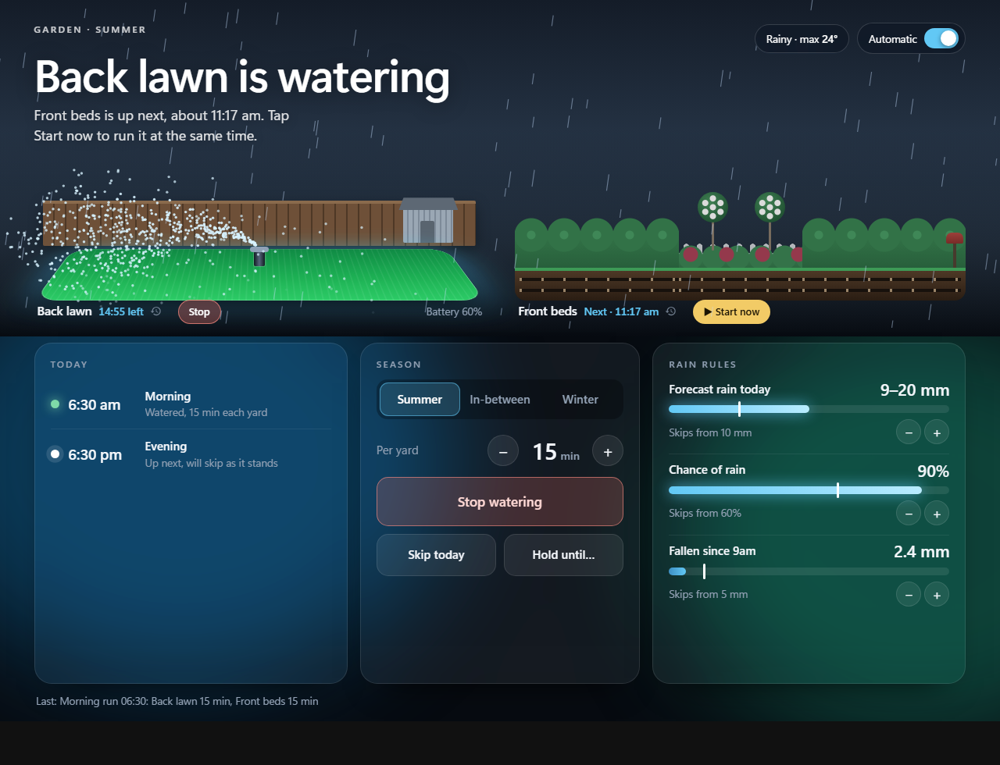
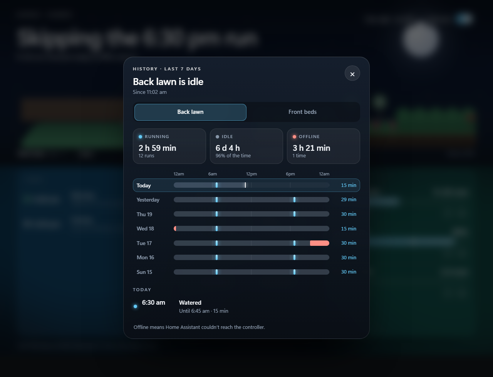
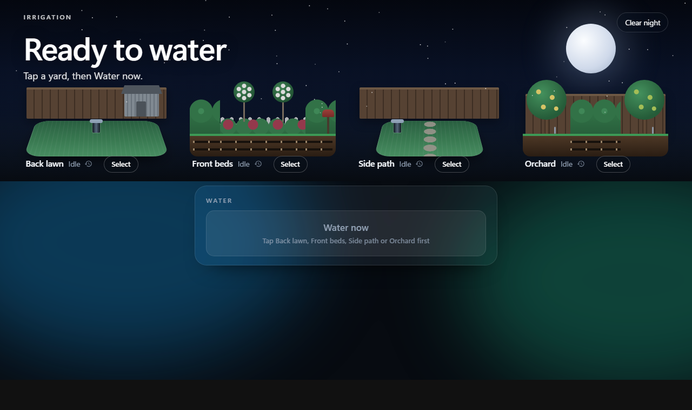
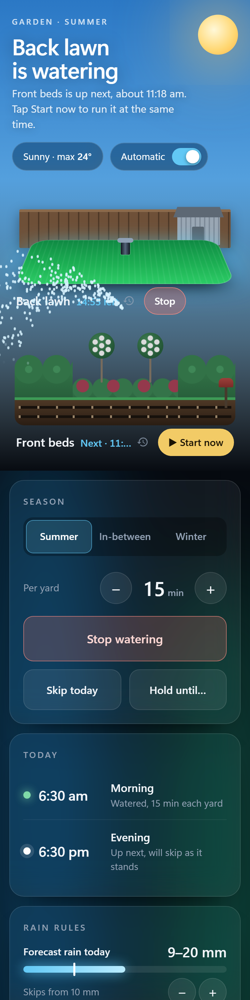

# Arcane Irrigation Card

A Home Assistant card for watering the garden. The sky follows your weather, the sprinklers spray while a yard waters, and each yard gets a little picture of its own: lawn, garden beds, fruit trees, fences, a shed or a letterbox.

[![hacs][hacs-badge]][hacs-link]
[![Buy Me a Coffee][bmc-badge]][bmc-link]



- **Tap a yard, then Water now.** With nothing but your switches or valves it works straight away.
- **Live countdown** and a spray animation while a yard waters.
- **7-day history.** Tap a yard's name to see when it ran, sat idle or was offline.
- **Six ready-made looks** for each yard, picked from a dropdown.
- **Grows with you.** Add helpers and scripts and it shows a schedule, seasons, rain rules, a queue and a Start now button.
- 1 to 4 yards. Works on a phone, a tablet or a wall screen.

Works with any `switch` or `valve` entity: Hunter, Rain Bird, Orbit B-hyve, OpenSprinkler, Shelly relays, ESPHome, Zigbee water valves and so on.

<p>
  
  
</p>
<p>
  
  
</p>

## Install

### HACS (recommended)

1. In HACS, open the three-dot menu, choose **Custom repositories**, add `https://github.com/deekay2153/arcane-irrigation-card` with the type **Dashboard**.
2. Search for **Arcane Irrigation Card** and download it.
3. Reload your browser.

### By hand

1. Download `arcane-irrigation-card.js` from the [latest release](https://github.com/deekay2153/arcane-irrigation-card/releases/latest).
2. Put it in `config/www/`.
3. In **Settings → Dashboards → ⋮ → Resources**, add `/local/arcane-irrigation-card.js` as a **JavaScript module**.

## Quick start

Add the card from the card picker (search "Arcane Irrigation") and pick your switches in the editor, or paste:

```yaml
type: custom:arcane-irrigation-card
zones:
  - entity: switch.back_lawn
    name: Back lawn
    scene: back_grass
  - entity: valve.front_beds
    name: Front beds
    scene: front_garden
```

That is a complete card. Tap a yard to select it, then **Water now**. The card turns the switch on (or opens the valve). **Stop** turns it off.

The card is made to fill the screen, so it looks best in a **Panel** view or a full-width section. Set `full_height: false` if you put it among other cards.

## Yard looks

| `scene` | Picture |
|---|---|
| `front_grass` | Lawn with a paver path, white picket fence, letterbox |
| `back_grass` | Lawn, timber paling fence, garden shed |
| `side_grass` | Narrow lawn strip with stepping stones, paling fence |
| `front_garden` | Hedge, rose bed, hedge on drip line, picket fence, letterbox |
| `back_garden` | Lemon tree, hedge, lime tree on drip line, paling fence |
| `side_garden` | Hedge and grass tree on drip line, paling fence |

Want your own planting? Give a yard a `layout` list instead (or as well; the scene then only adds its fence and props). Pick from `lawn`, `hedge`, `rosebed`, `grasstree`, `lime`, `lemon`, `orange`:

```yaml
  - entity: switch.orchard
    scene: back_garden
    layout: [orange, hedge, lemon]
```

## Configuration

Everything except the zones is optional. Panels only show when their entities are set.

### Card

| Option | What it does |
|---|---|
| `zones` | **Required.** 1 to 4 yards, see below. |
| `title` | Small heading at the top. Default `Irrigation`. |
| `full_height` | `false` stops the card filling the screen. Default `true`. |
| `weather` | A `weather.*` entity. Drives the sky: sun, clouds, rain, night. |
| `sun` | Default `sun.sun`. Used for day and night. |
| `max_temp` | A sensor with today's top temperature, shown next to the weather. |

### Zones

| Option | What it does |
|---|---|
| `entity` | **Required.** The `switch.*` or `valve.*` that waters this yard. |
| `name` | Name on the card. Defaults to the entity's name. |
| `scene` | One of the six looks above. |
| `layout` | Your own list of plants, see above. |
| `remaining` | Sensor with the time left. A number in seconds, minutes or hours (read from its unit), or a timestamp of when it ends. Shows a countdown. |
| `battery` | Battery sensor (%). Shown under the yard, red under 25%. |
| `status` | Any entity that goes `unavailable` when the controller is out of reach. The yard then shows **Offline**. (The yard also shows Offline when its switch or valve is unavailable.) |

### Schedule and helpers

These are for people who run their own watering schedule in Home Assistant. Each one is optional.

| Option | What it does |
|---|---|
| `automatic` | `input_boolean` for "the schedule is on". Shows the **Automatic** switch. |
| `season` | `input_select` (or `select`). Its options become the season buttons (up to 4). |
| `minutes` | `input_number` for minutes per yard. Shows the − / + stepper and is passed to your run script. |
| `times` | List of run times for the **Today** panel: `- name: Morning` with `entity: input_datetime.x` (or `time: "06:30"`). |
| `next_run` | Timestamp sensor with the next scheduled run. Drives the big heading. |
| `verdict` | Sensor that says whether the next run will water. A state starting with `water`, `on`, `true` or `yes` means water; anything else means skip. |
| `reason` | Sensor with the reason in words, e.g. `Skip: 12 mm forecast today`. |
| `log` | `input_text` holding the last event. Shown at the bottom. If its text starts with a run's name (`Morning run …`), the Today panel marks that run done, skipped (contains "skip") or failed (contains "did not start" or "failed"). |
| `hold` | `input_datetime` (date). While it is today or later the card says **On hold**. Shows a **Hold until…** button. |
| `queue` | `input_text` whose state names the yard that waters next (its entity id or name, anything after a `:` is ignored). That yard shows **Next** and a **Start now** button. |

### Scripts

Without scripts the card switches yards on and off itself. Add scripts to hand that job to your own logic.

```yaml
scripts:
  run: script.irrigation_run          # Water now
  stop: script.irrigation_stop        # Stop
  skip: script.irrigation_skip_today  # shows "Skip today"
  resume: script.irrigation_resume    # "Clear the hold" while on hold
  start_now: script.irrigation_start_now
```

The card starts them with `script.turn_on` and these variables:

| Script | Variables |
|---|---|
| `run` | `zones`: list of the picked switch/valve entity ids. `minutes`: the minutes helper's value, if set. |
| `start_now` | `zone`: the entity id of the queued yard to start right away. |
| `stop`, `skip`, `resume` | none |

### Rain rules

A panel of bars showing today's rain against the level that skips watering. The − / + buttons change that level.

```yaml
rain_rules:
  - name: Forecast rain today
    sensor: sensor.rain_forecast_today          # number, or a range like "5–10"
    threshold: input_number.skip_rain_mm        # optional
    max: 40                                     # length of the bar (optional)
  - name: Chance of rain
    sensor: sensor.rain_chance_today
    threshold: input_number.skip_rain_chance
```

`unit` is read from the sensor; set `unit:` to override it. The card only shows the rules: your own automation decides whether to skip.

## Full example

```yaml
type: custom:arcane-irrigation-card
title: Garden
weather: weather.home
max_temp: sensor.todays_high
zones:
  - entity: switch.back_lawn
    name: Back lawn
    scene: back_grass
    remaining: sensor.back_lawn_time_left
    battery: sensor.back_lawn_battery
  - entity: valve.front_beds
    name: Front beds
    scene: front_garden
automatic: input_boolean.irrigation_automatic
season: input_select.irrigation_season
minutes: input_number.irrigation_minutes
times:
  - name: Morning
    entity: input_datetime.irrigation_morning
  - name: Evening
    entity: input_datetime.irrigation_evening
next_run: sensor.irrigation_next_run
verdict: sensor.irrigation_verdict
reason: sensor.irrigation_reason
log: input_text.irrigation_last_event
hold: input_datetime.irrigation_hold_until
queue: input_text.irrigation_queue
scripts:
  run: script.irrigation_run
  stop: script.irrigation_stop
  skip: script.irrigation_skip_today
  resume: script.irrigation_resume
  start_now: script.irrigation_start_now
rain_rules:
  - name: Forecast rain today
    sensor: sensor.rain_forecast_today
    threshold: input_number.irrigation_skip_rain_mm
    max: 40
  - name: Chance of rain
    sensor: sensor.rain_chance_today
    threshold: input_number.irrigation_skip_rain_chance
```

## History

Tap a yard's name to open the last 7 days. Each day is a strip: blue while watering, grey while idle, red while offline. It reads Home Assistant's own history of the switch or valve, so it needs the recorder (on by default) and keeps whatever your recorder keeps. Very short drops that hit every yard at the same moment are shown as **Brief drop** and not counted as offline: those come from Home Assistant's side (a restart or reload), not the yard.

## Try it without Home Assistant

`preview/index.html` runs the card on made-up data. From the repo folder:

```
python -m http.server 8800
```

then open <http://127.0.0.1:8800/preview/index.html>. Add `?config=plain` for zones only or `?config=four` for four yards.

## Support

If this card makes your garden a little nicer, you can [buy me a coffee][bmc-link]. Thank you!

Found a bug or have an idea? [Open an issue](https://github.com/deekay2153/arcane-irrigation-card/issues).

## Licence

MIT, see [LICENSE](LICENSE).

[hacs-badge]: https://img.shields.io/badge/HACS-Custom-41BDF5.svg
[hacs-link]: https://hacs.xyz
[bmc-badge]: https://img.shields.io/badge/Buy%20me%20a%20coffee-FFDD00?logo=buymeacoffee&logoColor=black
[bmc-link]: https://www.buymeacoffee.com/deekay2153
